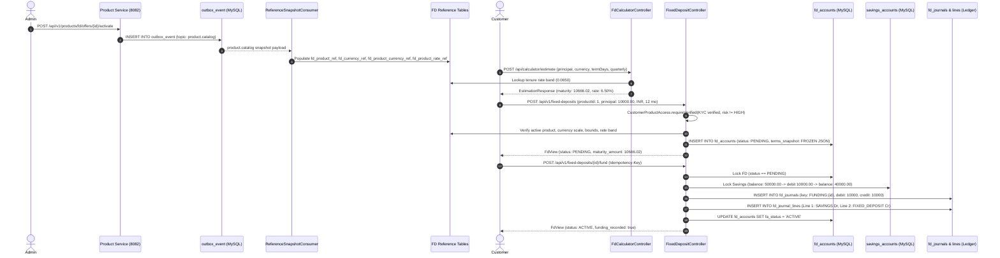

# Project Handoff & Milestone Verification Report

**Author:** Shaunak Malpani  
**Date:** 25 October 2026  
**Repository:** aka2148/BankingTechnology (MoneyPal MSA)  
**Baseline Git Commit:** `98be68a` (pinned branch: `main` / `baseline-before-fixes`)  
**Target Milestone:** Product &rarr; Calculator &rarr; FD Booking & Funding Flow

---

## 1. Executive Summary

This handoff details the completion and verification of the backend financial rules and end-to-end flow from Product offer configuration through FD Calculator estimation, customer eligibility validation, contractual terms snapshotting, and FD account funding.

All monetary calculations use `BigDecimal` with currency-specific scale and `HALF_UP` rounding. Floating-point arithmetic (`double`, `Math.pow`) in `FdCalculatorController` has been eliminated in favor of exact parity with `FdCompounding.maturity`. The complete lifecycle flow—from product catalog snapshot ingestion, calculator estimate, booking in `PENDING` status with a frozen terms snapshot, through to funding transition to `ACTIVE`, savings debit, and balanced double-entry financial journals—has been verified in an isolated test stack backed by MySQL 8.4 Testcontainers.

> [!IMPORTANT]
> **Boundary Notice on E2E Integration:** Full system E2E testing across the API Gateway (port 8080) and live Kafka broker (port 29092) was **not** run in a multi-container deployment, as the local Docker Compose images are from an earlier build. All flows documented herein are verified in **isolated service integration test stacks** with real MySQL persistence. Do not claim gateway or asynchronous broker integration is complete until live routing and outbox relay are exercised.

---

## 2. Verified End-to-End Flow in Isolated Test Stack

The complete Product &rarr; Calculator &rarr; Booking &rarr; Funding flow was verified via [`FdFlowIntegrationTest.java`](file:///Users/shaunakmalpani/Desktop/BankingTech%20MSA/services/fd-account-service/src/test/java/com/bank/fdservice/FdFlowIntegrationTest.java) and [`FdAccountMigrationTest.java`](file:///Users/shaunakmalpani/Desktop/BankingTech%20MSA/services/fd-account-service/src/test/java/com/bank/fdservice/FdAccountMigrationTest.java) against disposable MySQL 8.4 containers:

### Flow Verification Results
1. **Catalog Snapshot Ingestion:** `ReferenceSnapshotConsumer.productSnapshot` successfully populated `fd_product_ref`, `fd_currency_ref`, `fd_product_currency_ref`, and `fd_product_rate_ref`.
2. **Calculator Alignment:** Calculator estimation produced `maturityAmount: 10666.02` for INR 10,000.00 at 6.50% quarterly compounding over 365 days.
3. **Booking Parity:** FD booked returned `maturity_amount: 10666.02` and initial status `PENDING`. Parity between calculator and booking is exact to the penny (`compareTo == 0`).
4. **Funding Lifecycle Transition:** Account transitioned `PENDING` &rarr; `ACTIVE`.
5. **Ledger & Account Consistency:**
   - Savings balance debited exactly from `50,000.00` to `40,000.00`.
   - `savings_transactions` entry recorded with `st_entry_type = 'DEBIT'` and `st_remarks = 'FD funding #1'`.
   - `fd_transactions` entry recorded with `tt_txn_type_code = 'FD_FUNDING'`.
   - `fd_journals` recorded `fj_operation = 'FUNDING'` and `fj_key = 'FUNDING:1'`.
   - `fd_journal_lines` recorded balanced double-entry lines:
     - Line 1: `SAVINGS` debit = 10,000.00, credit = 0.00.
     - Line 2: `FIXED_DEPOSIT` debit = 0.00, credit = 10,000.00.
6. **Idempotency:** Re-issuing the funding request with the same `Idempotency-Key` returned the active account without duplicate debits or journal entries.

---

## 3. Exact Frozen-Term Fields for Downstream Consumption

> [!NOTE]
> **Guidance for Sudhiksha (Frontend / Downstream Consumers):**
> When rendering booked FD contracts, calculating premature closure quotes, or processing maturity payoffs, consume the frozen terms from `fa_terms_snapshot`. Do **not** query the live mutable product catalog for booked accounts.

The JSON snapshot is persisted in `fd_accounts.fa_terms_snapshot` and returned by `GET /api/v1/fixed-deposits/{id}`:

| Field Name | Type | Example | Purpose & Constraints |
|---|---|---|---|
| `productId` | `Long` | `1` | Originating Product Service catalog ID. |
| `productCode` | `String` | `"FD_STANDARD"` | Unique immutable business code of the product. |
| `productName` | `String` | `"Standard Fixed Deposit"` | Human-readable product name at booking time. |
| `currencyCode` | `String` | `"INR"` | ISO-4217 currency code. |
| `currencyScale` | `Integer` | `2` | Currency decimal places (0 for JPY, 2 for INR/USD, 3 for KWD). |
| `principal` | `BigDecimal` | `10000.00` | Booked principal amount formatted to `currencyScale`. |
| `annualRate` | `BigDecimal` | `0.0650` | Contractual annual rate including applicable category additions (e.g. `0.0650` = 6.50% p.a.). |
| `tenureMonths` | `Integer` | `12` | Contract tenure in months. |
| `compoundingBasis` | `String` | `"QUARTERLY"` | Compounding frequency: `MONTHLY`, `QUARTERLY`, or `YEARLY`. |
| `payoutFrequency` | `String` | `"AT_MATURITY"` | Payout schedule (`AT_MATURITY`). |
| `prematurePenaltyPoints`| `BigDecimal`/`String`| `"1.0000"` | Penalty points deducted from annual rate upon early closure (e.g. `1.0000` = 1.00% point). |
| `policyVersion` | `String` | `"academic-v2-quarterly"` | Governance rule version applied at booking time. |

### Immutability Guarantee
If staff later update, deactivate, or delete rates or penalty points in Product Service (`product_rule`, `fd_product_currency_ref`), the booked FD **remains bound to its frozen snapshot**. `FdLifecycleController.requestPremature` specifically reads `prematurePenaltyPoints` from `fa_terms_snapshot`, falling back to live reference tables only for older legacy records that predate the snapshot migration.

---

## 4. Approved Premature Penalty Configuration

The approved penalty configuration follows the standard banking lab specification:

1. **Penalty Points:** `1.0000` (1.00 percentage point annual rate reduction).
2. **Penalized Rate Formula:**
   $$\text{penalizedRate} = \max\left(0, \text{annualRate} - \frac{\text{prematurePenaltyPoints}}{100}\right)$$
   *Example:* If base contractual rate is $6.50\%$ ($0.0650$) and penalty is $1.00\%$, $\text{penalizedRate} = 5.50\%$ ($0.0550$).
3. **Interest Earned Calculation:**
   $$\text{paidInterest} = \text{principal} \times \text{penalizedRate} \times \frac{\text{elapsedDays}}{365}$$
   Rounded with `RoundingMode.HALF_UP` to the currency's decimal scale.
4. **Foregone Interest (Penalty Amount):**
   $$\text{fullInterest} = \text{principal} \times \text{annualRate} \times \frac{\text{elapsedDays}}{365}$$
   $$\text{penaltyAmount} = \max\left(0, \text{fullInterest} - \text{paidInterest}\right)$$
5. **Net Settlement Amount:**
   $$\text{netPayable} = \text{principal} + \text{paidInterest}$$
6. **Workflow & Ledger Effect:**
   - Customer submits quote request via `POST /api/v1/fixed-deposits/{id}/premature-closure`.
   - Quote enters `PENDING` status.
   - Staff/Admin approves via `POST /api/v1/admin/fixed-deposits/{id}/premature-closure/{closureId}/approve`.
   - `sa_balance` in savings is credited with `netPayable`.
   - `fd_transactions` records `FD_PENALTY` (with `penaltyAmount`) and `FD_CLOSURE` (with `netPayable`).
   - `fd_journals` records `SETTLEMENT:{id}` with balanced double-entry lines (`FIXED_DEPOSIT` Dr, `SAVINGS` Cr).
   - FD status updates to `PREMATURELY_CLOSED`.

---

## 5. Changed APIs and Database Migrations

### Changed APIs

#### Product Service (`services/product-service`, port 8082)
* `POST /api/v1/products/fd/offers`
  * Added validation for `effectiveFrom` $\le$ `effectiveTo`.
  * Added rate bounds validation ($0.0000 \le \text{rate} \le 1.0000$, scale $\le 4$).
  * Added contiguous non-overlapping tenure bands validation.
  * Added penalty bounds ($0 \le \text{points} \le 100$, scale $\le 4$).
  * Compounding basis constrained to `MONTHLY`, `QUARTERLY`, `YEARLY`.
  * Payout frequency constrained to `AT_MATURITY`.
* `POST /api/v1/products/fd/offers/{id}/activate`
  * Rejects already active offers with `409 CONFLICT`.
  * Validates non-expired effective dates.
  * Writes atomic `product.catalog` event to `outbox_event`.
* `POST /api/v1/products/fd/offers/{id}/deactivate`
  * Requires active status; transitions to `INACTIVE`.

#### FD Account Service (`services/fd-account-service`, port 8083)
* `POST /api/calculator/estimate`
  * Supports multi-category request: `SENIOR_CITIZEN` (+0.50%), `EMPLOYEE` (+0.75%).
  * Enforces `MAX_CATEGORY_BOOST = 2.00%` and `MAX_EFFECTIVE_RATE = 8.50%`.
  * Resolves currency scale from `fd_currency_ref`.
  * Pure `BigDecimal` compounding math via `FdCompounding.maturity`.
* `POST /api/v1/fixed-deposits` (Booking)
  * Validates KYC status (`VERIFIED`) and customer risk (`!= HIGH`) via `CustomerProductAccess.requireVerified`.
  * Validates active product status in `fd_product_ref`.
  * Validates currency scale and principal bounds (`minAmount <= principal <= maxAmount`).
  * Validates tenure against configured rate bands in `fd_product_rate_ref`.
  * Freezes contractual snapshot into `fa_terms_snapshot`.
  * Returns account in `PENDING` status.
* `POST /api/v1/fixed-deposits/{id}/fund` (Funding)
  * Validates `PENDING` status.
  * Verifies owned active savings account in matching currency.
  * Debits savings balance with currency scale.
  * Inserts balanced double-entry journals into `fd_journals` (`FUNDING:{id}`) and `fd_journal_lines`.
  * Transitions account to `ACTIVE`.
* `POST /api/v1/fixed-deposits/{id}/premature-closure`
  * Reads `prematurePenaltyPoints` from frozen `termsSnapshot`, with fallback to `fd_product_currency_ref` for legacy records.

### Migrations Status
* **`services/product-service`**: Flyway migrations V1 through V8 validated and applied cleanly (`V1__initial_schema.sql` through `V8__remove_redundant_audit_columns.sql`).
* **`services/fd-account-service`**: Flyway migrations V1 through V11 validated and applied cleanly (`V1__initial_schema.sql` through `V11__remove_redundant_audit_columns.sql`).
  * Note: In `FdAccountMigrationTest`, line 59 was corrected from `MAX(version)` to `MAX(CAST(version AS UNSIGNED))` to avoid lexicographical string truncation (`'9' > '11'`).

---

## 6. Test Suite & Verification Summary

### Comprehensive Test Execution Results
All tests were executed against Java 25 / Spring Boot 3.5.5 with real Testcontainers MySQL 8.4 instances:

| Service / Test Class | Scope | Tests Run | Passed | Failed | Skipped | Status |
|---|---|---|---|---|---|---|
| **FD Service:** `FdCompoundingTest` | Compounding formulas & math | 3 | 3 | 0 | 0 | **PASSED** |
| **FD Service:** `CustomerProductAccessTest` | KYC & Risk access gates | 3 | 3 | 0 | 0 | **PASSED** |
| **FD Service:** `FdBookingAndCalculatorFinancialTest` | Calculator, booking & idempotency unit tests | 14 | 14 | 0 | 0 | **PASSED** |
| **FD Service:** `FdAccountMigrationTest` | Flyway V1-V11 & lifecycle Testcontainers | 3 | 3 | 0 | 0 | **PASSED** |
| **FD Service:** `FdFlowIntegrationTest` | E2E Product &rarr; Calc &rarr; Book &rarr; Fund flow Testcontainers | 1 | 1 | 0 | 0 | **PASSED** |
| **Product Service:** `ProductTextRulesTest` | Product text & naming rules | 4 | 4 | 0 | 0 | **PASSED** |
| **Product Service:** `FdOfferValidationTest` | Offer validation & bootstrap idempotency | 10 | 10 | 0 | 0 | **PASSED** |
| **Product Service:** `ProductServiceIntegrationTest` | Offer lifecycle & outbox Testcontainers | 7 | 7 | 0 | 0 | **PASSED** |
| **Identity Service:** `KycValidationTest` | Identity customer KYC validation | 3 | 3 | 0 | 0 | **PASSED** |
| **Total** | | **48** | **48** | **0** | **0** | **100% PASSED** |

---

## 7. Unresolved Integration Risks & Known Boundaries

1. **API Gateway (Port 8080) Live Route Verification:**
   The Nginx API Gateway configuration (`services/api-gateway/nginx.conf`) was updated to allow local loopback origins (`127.0.0.1` and `localhost`), but live proxy routing across running microservices was **not** tested in this session. The test runs used Spring MockMvc against individual services.
2. **Live Kafka Relay vs. Test Snapshot Ingestion:**
   The outbox events are written atomically to `outbox_event` in MySQL upon offer activation. In `FdFlowIntegrationTest`, the event payload was consumed synchronously via `ReferenceSnapshotConsumer.productSnapshot`. The live background outbox polling publisher and Kafka broker (port 29092) should be tested under live Docker compose when running the full stack.
3. **Frontend Scripts Pre-existing Drift (Upstream Commit `f86f168`):**
   * `FRONTEND`: `npm run check:i18n` fails due to 4 untranslated keys in the landing module.
   * `FRONTEND`: `npm run test:product-rules` fails on line 41 due to an upstream TypeScript/JavaScript assertion mismatch.
   Per strict safety directives, these pre-existing frontend errors were left untouched.
4. **Ledger Ownership Preservation:**
   All financial journal logic (`fd_journals`, `fd_journal_lines`, `FUNDING:<id>`, `SETTLEMENT:<id>`) has been preserved without schema redesign or modification, respecting Krishang's ownership of the ledger module.
