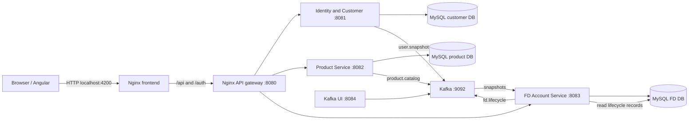
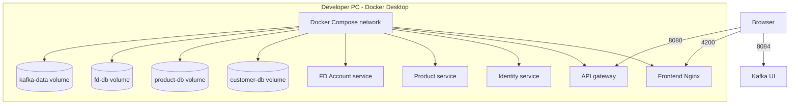

# MoneyPal active architecture and deployment

This document describes the active Spring Boot/Angular microservice stack in `docker-compose.yml`. `BACKEND/` contains retained legacy monolith code and migration sources; it is not an active request path.

## Request and event flow



Identity owns customer credentials, profile, KYC, roles, and verified email registry. Product owns product catalog, offer terms, currencies, and rate bands. FD Account owns savings/FD accounts, accruals, lifecycle statements/notices, transactions, and journals. Cross-service customer/product reference data reaches FD through `user.snapshot` and `product.catalog`; there is no shared application database.

The FD lifecycle writes statement and notice metadata through its existing lifecycle record service. The report API reads those rows and does not add a second writer. FD summary values come from persisted account and accrual data. They are grouped by currency and decimal scale; stored maturity amounts are labeled as stored values, not recalculated estimates.

## Local Compose deployment

The supported deployment exercised in this repository is Docker Compose on a developer machine. It includes three MySQL containers, Kafka, the three application services, API gateway, Kafka UI, and the frontend Nginx server. The React-like SPA is Angular, built in the frontend image and served at `http://localhost:4200`; the API gateway is `http://localhost:8080`.



Start with an existing ignored `.env` and the Linux container engine:

```powershell
docker compose up --build -d
docker compose ps
Invoke-RestMethod http://localhost:8080/gateway/health
```

The Compose environment is configured with persistent named local volumes. `docker compose down` stops the stack but retains data. `docker compose down -v` deletes those volumes; only use it when intentionally discarding local demo data. The isolated audit stack is separate and uses its own Compose project name/volumes.

Compose enables the FD scheduler for its single FD service instance. Daily interest accrual runs at 00:00 and the maturity/statement catch-up batch runs at 01:00 in `Asia/Kolkata` by default. Set `FD_BATCH_SCHEDULE_ENABLED=false` to disable the cron jobs; `FD_BATCH_INTEREST_CRON`, `FD_BATCH_MATURITY_CRON`, `FD_BATCH_ZONE`, and `FD_BUSINESS_ZONE` configure the schedules and business date zone.

The staff demo clock remains available with scheduled processing enabled. Advancing the clock still runs the existing full daily batch immediately, and `/api/admin/clock/run-daily` runs it for the current business date. Resetting the clock resets only its offset; it does not roll back account history. Keep the FD service to one replica while its scheduler is enabled so the full batch scan is started by only one instance.

## Deployment evidence and limits

No Azure, Kubernetes, or other cloud deployment has been executed or verified in this work. The diagrams above describe the local Compose topology only. Cloud infrastructure, production TLS/secret management, broker authentication, backup/restore, high availability, and production operations are not represented as completed deployment work.

The project planning pages contain historical descriptions of a PostgreSQL baseline; the active Compose manifests and service configuration currently use separate MySQL 8.4 databases. For the current runnable stack, follow this document and the root README.
